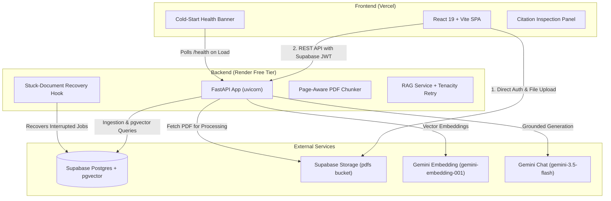

# 🎓 AI Mentor — Grounded PDF Study & Interview Mentor

An AI-powered study and interview preparation workspace built with **FastAPI**, **React 19**, **Supabase (PostgreSQL + pgvector)**, and **Google Gemini**.

Upload lecture slides, textbooks, or interview prep guides (up to 10 MB). AI Mentor extracts text page by page, chunks content with page awareness, generates 768-dimensional vector embeddings, and delivers answers grounded strictly in the uploaded document with clickable, page-level citations.

---

## 🏛️ System Architecture



---

## 🛠️ Technology Stack

| Layer | Technologies |
| :--- | :--- |
| **Frontend** | React 19, TypeScript, Vite 8, Tailwind CSS v4, TanStack Router & Query, Sonner, Lucide React |
| **Backend** | Python 3.13, FastAPI, Uvicorn, PyMuPDF (Fitz), Tenacity, NumPy, Pydantic Settings |
| **Database & Auth** | Supabase (PostgreSQL 15 + `pgvector`), Row-Level Security (RLS), Supabase Storage |
| **AI Models** | Google Gemini (`gemini-embedding-001` with 768-dim L2 normalization, `gemini-3.5-flash`) |
| **Deployment** | Vercel (Frontend SPA), Render (Backend Web Service), Supabase Cloud |

---

## ⚙️ Environment Variables Reference

### Backend (`backend/.env` or Render Dashboard)
> **Note:** Never commit secrets to source control. Configure these in the Render Dashboard or your local `backend/.env`.

| Variable | Description | Example / Default |
| :--- | :--- | :--- |
| `SUPABASE_URL` | Your Supabase project URL | `https://xyzcompany.supabase.co` |
| `SUPABASE_SERVICE_ROLE_KEY` | Supabase service role secret key | `eyJhbGciOi...` *(Secret)* |
| `GEMINI_API_KEY` | Google AI Studio Gemini API key | `AIzaSy...` *(Secret)* |
| `GEMINI_EMBED_MODEL` | Embedding model identifier | `gemini-embedding-001` |
| `GEMINI_CHAT_MODEL` | Chat LLM identifier | `gemini-3.5-flash` |
| `EMBED_DIM` | Target embedding vector dimension | `768` |
| `ALLOWED_ORIGINS` | Comma-separated allowed frontend origins | `https://your-app.vercel.app,http://localhost:5173` |
| `ENVIRONMENT` | Environment name | `production` (or `development`) |
| `PORT` | Web server port (Render injects this) | `8000` |
| `MAX_PDF_SIZE_MB` | Maximum allowed PDF upload size in megabytes | `10` |
| `MAX_DOCS_PER_USER` | Maximum active documents allowed per user account | `5` |
| `MAX_QUESTIONS_PER_USER_PER_DAY` | Maximum daily questions per user (checked via `query_logs`) | `50` |
| `MAX_QUESTION_LENGTH` | Maximum character length for a question | `1000` |
| `SIMILARITY_THRESHOLD` | Cosine similarity cutoff for RAG retrieval | `0.45` |
| `TOP_K` | Number of chunks retrieved per question | `6` |

### Frontend (`frontend/.env` or Vercel Dashboard)

| Variable | Description | Example |
| :--- | :--- | :--- |
| `VITE_SUPABASE_URL` | Your Supabase project URL (public) | `https://xyzcompany.supabase.co` |
| `VITE_SUPABASE_ANON_KEY` | Your Supabase public anonymous API key | `eyJhbGciOi...` *(Public)* |
| `VITE_API_BASE_URL` | URL of your deployed Render backend | `https://ai-mentor-backend.onrender.com` |

---

## 🚀 Deployment Guide

### 1. Backend Deployment on Render

1. Fork or push this repository to GitHub.
2. Sign in to [Render](https://dashboard.render.com/) and click **New + → Web Service**.
3. Connect your repository.
4. Select **Blueprint** (Render will automatically detect `render.yaml`) **OR** configure manually:
   - **Name:** `ai-mentor-backend`
   - **Root Directory:** `backend`
   - **Runtime:** `Python 3`
   - **Build Command:** `pip install -r requirements.txt`
   - **Start Command:** `uvicorn app.main:app --host 0.0.0.0 --port $PORT`
   - **Health Check Path:** `/health`
   - **Plan:** `Free`
5. In the **Environment Variables** tab, add your secrets:
   - `SUPABASE_URL`
   - `SUPABASE_SERVICE_ROLE_KEY`
   - `GEMINI_API_KEY`
   - `ALLOWED_ORIGINS` (Set to your Vercel URL e.g. `https://your-app.vercel.app`)
6. Click **Deploy Web Service**. Note your backend URL (e.g. `https://ai-mentor-backend.onrender.com`).

---

### 2. Frontend Deployment on Vercel

1. Sign in to [Vercel](https://vercel.com/) and click **Add New → Project**.
2. Import your GitHub repository.
3. Configure project settings:
   - **Framework Preset:** `Vite`
   - **Root Directory:** `frontend`
   - **Build Command:** `pnpm run build` (or `npm run build`)
   - **Output Directory:** `dist`
4. In the **Environment Variables** section, add:
   - `VITE_SUPABASE_URL`: Your Supabase URL
   - `VITE_SUPABASE_ANON_KEY`: Your Supabase public anonymous key
   - `VITE_API_BASE_URL`: Your Render backend URL (`https://ai-mentor-backend.onrender.com`)
5. Click **Deploy**. Vercel will build the SPA and configure rewrites via `frontend/vercel.json`.

---

### 3. Supabase Auth Configuration

1. In your [Supabase Dashboard](https://supabase.com/dashboard), navigate to **Authentication → URL Configuration**.
2. Set **Site URL** to your Vercel production domain:
   ```text
   https://your-app.vercel.app
   ```
3. In **Redirect URLs**, add:
   ```text
   https://your-app.vercel.app/**
   http://localhost:5173/**
   ```
4. Save changes. This ensures email confirmation and password reset links route to your production app.

---

## ⚠️ Known Limitations (Free Tier Hosting)

- **Render Cold Starts:** The free tier of Render spins down services after 15 minutes of inactivity. When a request arrives, the first response can take ~45–60 seconds to spin up. AI Mentor features an automatic **Cold-Start Banner** on the frontend that detects this state, notifies the user, and retries automatically.
- **Ephemeral Storage on Render:** Any temporary files created on disk during PDF processing are discarded on server restart or sleep. AI Mentor relies solely on Supabase Storage (`pdfs` bucket) and never expects local disk persistence.
- **Scanned PDFs & OCR:** Only selectable text in PDFs is extracted (via PyMuPDF). Scanned document images without an embedded text layer will trigger a clean error: `"No extractable text (scanned PDF). OCR is not supported yet."`
- **Interrupted Ingestion Recovery:** If Render restarts or sleeps during a background document ingestion job, the backend's startup hook automatically detects documents stuck in `processing` state for over 10 minutes, marks them as failed, and enables a 1-click **Retry** button in the UI.

---

## 🧪 Post-Deployment Test Checklist

After completing your deployments, perform this step-by-step verification:

- [ ] **Health Endpoint:** Open `https://<render-backend>/health` in your browser. Verify it returns `{"status":"ok","environment":"production"}`.
- [ ] **Cold Start UX:** Open `https://<vercel-frontend>` while the backend is asleep. Verify the cold-start banner appears (`Waking up the server...`) and automatically dismisses once the backend is ready.
- [ ] **Authentication:** Sign up with a new email and log in. Verify session tokens are issued and user profile displays in the bottom sidebar.
- [ ] **PDF Upload & Ingestion:** Upload a 2–10 MB PDF. Verify the status updates from `processing` to `ready` within 10–30 seconds.
- [ ] **Quota & Abuse Enforcement:**
  - Try uploading a file > 10 MB: Verify friendly error `"File exceeds maximum allowed size of 10 MB."`
  - Try uploading a 6th document (if limit is 5): Verify `"Document limit reached (5 documents maximum per user)." `
- [ ] **Grounded Chat & Citations:**
  - Ask a question contained in the PDF: Verify formatted bullet points (no stray asterisks) and numbered blue citation chips `[1]`, `[2]`.
  - Click a citation chip: Verify side panel opens, shows highlighted supporting sentences with context, and provides a `"Show full passage"` toggle.
  - Ask an out-of-domain question: Verify fallback response `"I couldn't find this in the uploaded document."` without hallucinations.
- [ ] **Document Retry:** If a document encounters an error or interruption, click the **Retry** button in the document table to ensure it re-processes cleanly.
- [ ] **SPA Route Refresh:** Refresh the page while at `/chat/<documentId>` or `/documents`. Verify Vercel serves the route without 404 errors.
- [ ] **About Modal Attribution:** Click your profile in the sidebar → **About & Credits**. Verify the dialog displays and credits `satnaing/shadcn-admin` (MIT).

---

## 📜 Open-Source Attribution & License

- UI layout and admin scaffolding based on [satnaing/shadcn-admin](https://github.com/satnaing/shadcn-admin), licensed under the **MIT License**.
- Project licensed under the **MIT License**.
